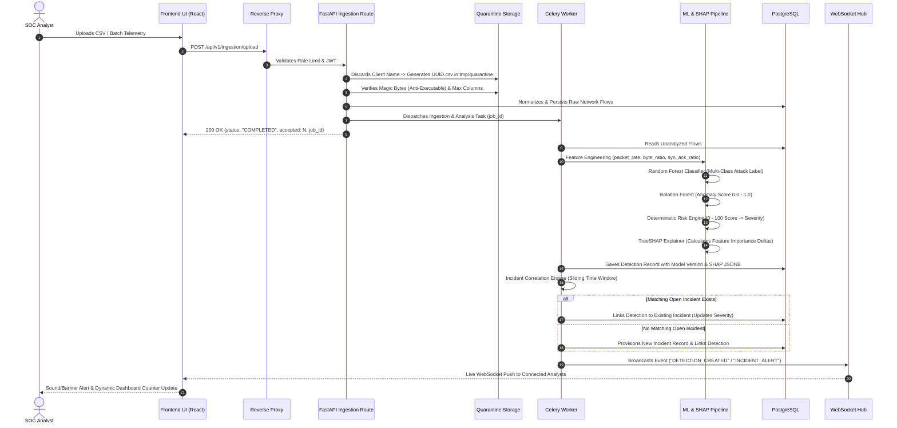

# Sentinel-X: Data Flow & Telemetry Processing Lifecycle

## 1. Overview

The Sentinel-X data pipeline ingests raw network flow telemetry, normalizes and validates features, executes dual-model machine learning inference, generates SHAP feature attributions, correlates related detections into manageable security incidents, and broadcasts real-time alerts to connected SOC consoles.

---

## 2. End-to-End Processing Sequence

---

## 3. Data Ingestion & Quarantine Pipeline

All file uploads strictly adhere to the Section 32 multi-barrier quarantine pipeline:

1. **Authentication & RBAC:** Calling user must possess `ADMIN` or `ANALYST` role.
2. **File Size Check:** Rejects payload if $> 10\text{ MB}$.
3. **Extension Allowlist:** Only `.csv` and `.json` permitted.
4. **Executable Magic Bytes Inspection:** Inspects leading header bytes for signatures:
   - `b"MZ"` (Windows PE/Executable)
   - `b"\x7fELF"` (Linux ELF binary)
   - `b"\xca\xfe\xba\xbe"` (Mach-O / Java bytecode)
   - `b"#!/bin/"` or `b"#!/usr/bin/"` (Shell scripts)
5. **Path Traversal Filename Discard:** Original user-supplied filename is never used on disk. Files are written to `tmp/quarantine/<uuid4>.<ext>`.
6. **CSV Formula Injection Sanitization:** Cells starting with `=, +, -, @, \t, \r` are prefixed with a single quote (`'`) to disable Dynamic Data Exchange (DDE) formula execution upon analyst export.
7. **Column Count Enforcement:** Rejects CSV files exceeding 100 columns to guard against memory exhaustion attacks.
8. **Quarantine Eviction:** Immediately after parsing into validated database objects, the quarantine file is unlinked from the filesystem.

---

## 4. Machine Learning & Risk Scoring Pipeline

### 4.1 Feature Engineering
Raw network flows are transformed into 14 normalized numerical features:
- `packet_rate`: Packets per millisecond.
- `byte_rate`: Bytes per millisecond.
- `avg_packet_size`: $\text{bytes} / \text{packets}$.
- `port_class`: Privileged ($<1024$), Registered ($1024-49151$), Ephemeral ($>49151$).
- Protocol One-Hot encoding (TCP, UDP, ICMP).

### 4.2 Multi-Model Ensemble
- **Classifier (Supervised):** Random Forest predicting: `BENIGN`, `DOS_DDOS`, `PORTSCAN`, `BRUTE_FORCE`, `MALWARE_C2`.
- **Anomaly Detector (Unsupervised):** Isolation Forest scoring deviation from baseline benign traffic.
- **Explainability (TreeSHAP):** Calculates Exact Shapley values indicating top positive and negative risk contributors.

### 4.3 Deterministic Risk Formula
$$\text{Risk} = \min\left(100, \max\left(0, W_{\text{class}} \cdot C + W_{\text{anom}} \cdot A + W_{\text{threat}} \cdot T + W_{\text{hist}} \cdot H\right)\right)$$
- **Severity Mapping:**
  - $0 \le \text{Risk} < 25$: `LOW`
  - $25 \le \text{Risk} < 60$: `MEDIUM`
  - $60 \le \text{Risk} < 85$: `HIGH`
  - $85 \le \text{Risk} \le 100$: `CRITICAL`
