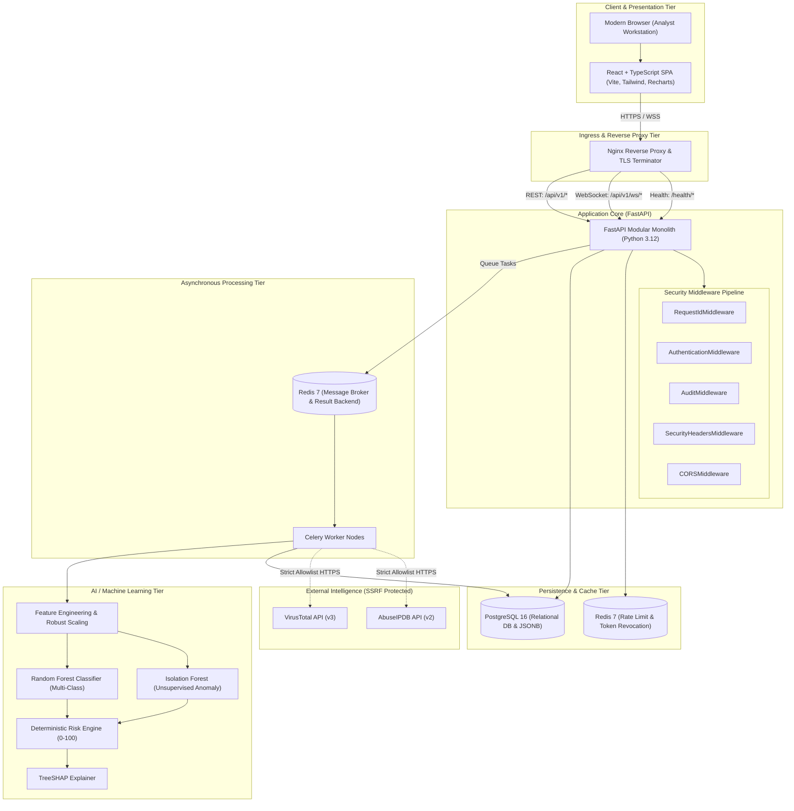

# Sentinel-X: System Architecture Specification

## 1. Executive Summary

**Sentinel-X** is an enterprise-grade AI-powered Security Operations Center (SOC) and Network Threat Detection platform. It provides automated network telemetry ingestion, real-time machine learning threat classification, unsupervised anomaly detection, deterministic risk scoring, Explainable AI (TreeSHAP), automated incident correlation, and a reactive analyst investigation dashboard.

The platform is designed as a **hardened modular monolith** with dedicated asynchronous background workers, strict trust boundaries, least-privilege role-based access control (RBAC), and zero-secret exposure.

---

## 2. High-Level Architecture Diagram

---

## 3. Core Architectural Subsystems

### 3.1 Presentation Tier (Frontend UI)
* **Framework:** React 18, TypeScript 5, Vite 6, Tailwind CSS 3.
* **Theme & Ergonomics:** High-contrast SOC dark theme strictly adhering to `#0A0A0A` (Jet Black), `#007BA7` (Cerulean Blue), `#FF2D95` (Neon Rose), and ANSI severity indicators.
* **Authentication Storage:** Access tokens stored exclusively in volatile JavaScript runtime memory; refresh tokens maintained in `HttpOnly`, `SameSite=Lax`, `Secure` browser cookies.
* **Telemetry Visualizations:** Recharts for volume timelines and attack distribution; SVG attack path topology nodes; Waterfall feature attribution charts for SHAP explanations.

### 3.2 Ingress & Gateway Tier (Nginx)
* **TLS Termination & Header Hardening:** Disables server tokens (`server_tokens off`), injects HSTS, CSP, X-Frame-Options (`DENY`), and X-Content-Type-Options (`nosniff`).
* **Rate-Limiting Zones:** 
  - `auth_limit`: 10 requests/min burst=5 for authentication routes.
  - `api_limit`: 120 requests/min burst=30 for general REST endpoints.
* **WebSocket Proxying:** Native `Upgrade` and `Connection: upgrade` forwarding for reactive SOC dashboard alerts.

### 3.3 Application Core (FastAPI Modular Monolith)
* **Architecture:** Structured domain layers (`core`, `middleware`, `api/v1`, `db/models`, `schemas`, `repositories`, `services`, `ml`, `threat_intel`, `workers`).
* **Validation Standard:** Pydantic v2 strict schema validation with `extra="forbid"` on sensitive request models.
* **Centralized Exception Envelope:** Uniform `{data, meta}` and `{error: {code, message, details}, meta}` JSON envelopes. Internal stack traces are NEVER exposed.

### 3.4 Asynchronous Worker (Celery + Redis)
* Offloads computationally intensive pipelines:
  - Telemetry CSV/JSON parsing and batch quarantine.
  - ML inference and TreeSHAP calculation.
  - Threat intelligence external indicator enrichment.
  - PDF, CSV, and JSON compliance report compilation.

### 3.5 Storage & Persistence Tier
* **PostgreSQL 16:** Relational integrity with foreign key check constraints, B-Tree indexes on search fields (`detected_at`, `status`, `severity`), and JSONB columns for flexible SHAP feature attribution weights.
* **Redis 7:** Token revocation store, sliding-window rate limit counters, and Celery task broker.
