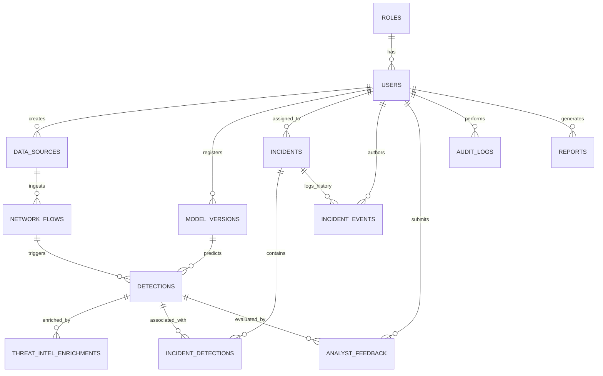

# Sentinel-X Database Schema Specification

## 1. Overview & Architecture

Sentinel-X utilizes **PostgreSQL 16** as its primary relational store. The schema is normalized (3NF) for analytical integrity, high-throughput writes (flow ingestion), and low-latency point queries (SOC analyst dashboard).

### Key Architectural Tenets
- **Primary Keys**: Canonical UUIDv4 strings (`VARCHAR(36)` / `UUID`) across all operational entities.
- **Temporal Tracking**: UTC `TIMESTAMPTZ` (`created_at`, `updated_at`) enforced via `TimestampMixin`.
- **Integrity Constraints**: Explicit SQL check constraints (`CheckConstraint`) on probabilities, scores, enums.
- **Relational Integrity**: Strict foreign key constraints with explicit `ON DELETE CASCADE` or `RESTRICT` actions.
- **Audit Immutability**: `audit_logs` is append-only; update/delete operations are forbidden at the database trigger layer.

---

## 2. Entity-Relationship Diagram (ERD)

---

## 3. Detailed Table Specifications

### 3.1 `roles`
Defines RBAC permission tiers (`ADMIN`, `ANALYST`, `VIEWER`).
| Column | Type | Constraints | Description |
|:---|:---|:---|:---|
| `id` | `VARCHAR(36)` | PRIMARY KEY | Unique UUID identifier |
| `name` | `VARCHAR(50)` | UNIQUE, NOT NULL | Role name (`ADMIN`, `ANALYST`, `VIEWER`) |
| `description` | `TEXT` | NULLABLE | Human-readable role description |
| `permissions` | `JSONB` | NOT NULL, DEFAULT `'[]'` | List of fine-grained privilege strings |
| `created_at` | `TIMESTAMPTZ` | NOT NULL | Record creation timestamp |
| `updated_at` | `TIMESTAMPTZ` | NOT NULL | Record modification timestamp |

---

### 3.2 `users`
Operational user accounts, credential hashes, and assigned roles.
| Column | Type | Constraints | Description |
|:---|:---|:---|:---|
| `id` | `VARCHAR(36)` | PRIMARY KEY | Unique UUID identifier |
| `role_id` | `VARCHAR(36)` | FK(`roles.id`, RESTRICT), INDEX | Assigned RBAC role |
| `email` | `VARCHAR(255)` | UNIQUE, NOT NULL, INDEX | Analyst or admin email address |
| `password_hash` | `TEXT` | NOT NULL | Argon2id cryptographic hash |
| `full_name` | `VARCHAR(120)` | NOT NULL | Operator display name |
| `is_active` | `BOOLEAN` | NOT NULL, DEFAULT `true` | Account active state |
| `last_login_at`| `TIMESTAMPTZ` | NULLABLE | Last successful authentication |
| `created_at` | `TIMESTAMPTZ` | NOT NULL | Account creation timestamp |
| `updated_at` | `TIMESTAMPTZ` | NOT NULL | Profile update timestamp |

---

### 3.3 `data_sources`
Catalog of network capture sensors, log shippers, and ingestion streams.
| Column | Type | Constraints | Description |
|:---|:---|:---|:---|
| `id` | `VARCHAR(36)` | PRIMARY KEY | Sensor UUID identifier |
| `created_by` | `VARCHAR(36)` | FK(`users.id`), NOT NULL | Registered admin user |
| `name` | `VARCHAR(100)` | UNIQUE, NOT NULL | Sensor name (e.g. `perimeter-gw-01`) |
| `source_type` | `VARCHAR(50)` | NOT NULL | Source type (`PCAP_OFFLINE`, `SYSLOG`, `NETFLOW`) |
| `status` | `VARCHAR(30)` | NOT NULL, DEFAULT `'ACTIVE'` | Health state (`ACTIVE`, `DEGRADED`, `OFFLINE`) |
| `metadata` | `JSONB` | NULLABLE | Interface, MTU, or sensor configuration |
| `created_at` | `TIMESTAMPTZ` | NOT NULL | Creation timestamp |

---

### 3.4 `network_flows`
Normalized bidirectional network communication records (5-tuple and flow telemetry).
| Column | Type | Constraints | Description |
|:---|:---|:---|:---|
| `id` | `VARCHAR(36)` | PRIMARY KEY | Unique Flow record UUID |
| `data_source_id`| `VARCHAR(36)` | FK(`data_sources.id`), NOT NULL | Ingesting source sensor |
| `src_ip` | `VARCHAR(45)` | NOT NULL, INDEX | Source IPv4/IPv6 address |
| `dst_ip` | `VARCHAR(45)` | NOT NULL, INDEX | Destination IPv4/IPv6 address |
| `src_port` | `INTEGER` | NOT NULL, CHECK(`0-65535`) | Source transport port |
| `dst_port` | `INTEGER` | NOT NULL, CHECK(`0-65535`) | Destination transport port |
| `protocol` | `VARCHAR(20)` | NOT NULL | Transport protocol (`TCP`, `UDP`, `ICMP`) |
| `start_time` | `TIMESTAMPTZ` | NOT NULL, INDEX | Flow inception timestamp |
| `end_time` | `TIMESTAMPTZ` | NOT NULL | Flow termination timestamp |
| `duration` | `NUMERIC(14,4)`| NOT NULL, CHECK(`duration >= 0`) | Duration in seconds |
| `src_bytes` | `BIGINT` | NOT NULL, CHECK(`src_bytes >= 0`) | Ingress byte volume |
| `dst_bytes` | `BIGINT` | NOT NULL, CHECK(`dst_bytes >= 0`) | Egress byte volume |
| `src_packets` | `BIGINT` | NOT NULL, CHECK(`src_packets >= 0`)| Ingress packet volume |
| `dst_packets` | `BIGINT` | NOT NULL, CHECK(`dst_packets >= 0`)| Egress packet volume |
| `tcp_flags` | `VARCHAR(20)` | NULLABLE | Aggregated TCP control flags |
| `features` | `JSONB` | NOT NULL | 42 statistical telemetry features |

---

### 3.5 `model_versions`
Registry of trained AI/ML classification and anomaly models.
| Column | Type | Constraints | Description |
|:---|:---|:---|:---|
| `id` | `VARCHAR(36)` | PRIMARY KEY | Model UUID identifier |
| `name` | `VARCHAR(100)` | NOT NULL | Model family (e.g. `XGBoost-ThreatClassifier`) |
| `version` | `VARCHAR(50)` | NOT NULL | Semantic version string (`1.2.0`) |
| `model_type` | `VARCHAR(50)` | NOT NULL | `SUPERVISED_CLASSIFIER`, `UNSUPERVISED_ANOMALY` |
| `status` | `VARCHAR(30)` | NOT NULL | `ACTIVE`, `STAGING`, `ARCHIVED`, `FAILED` |
| `metrics` | `JSONB` | NOT NULL | Precision, Recall, F1-Score, ROC-AUC |
| `artifact_path`| `VARCHAR(500)` | NOT NULL | File storage location of trained model weights |
| `created_by` | `VARCHAR(36)` | FK(`users.id`), NOT NULL | User who registered/promoted model |
| `created_at` | `TIMESTAMPTZ` | NOT NULL | Registration timestamp |

---

### 3.6 `detections`
Security anomaly and threat classifications produced by the ML inference engine.
| Column | Type | Constraints | Description |
|:---|:---|:---|:---|
| `id` | `VARCHAR(36)` | PRIMARY KEY | Unique detection UUID |
| `flow_id` | `VARCHAR(36)` | FK(`network_flows.id`, CASCADE) | Associated network flow |
| `model_version_id`| `VARCHAR(36)`| FK(`model_versions.id`, RESTRICT) | Model that scored the event |
| `attack_type` | `VARCHAR(50)` | NOT NULL, INDEX | Classified threat (`DDoS`, `PortScan`, etc.) |
| `confidence` | `NUMERIC(5,4)` | NOT NULL, CHECK(`0 <= confidence <= 1`) | Model certainty |
| `risk_score` | `NUMERIC(5,2)` | NOT NULL, CHECK(`0 <= risk_score <= 100`) | Deterministic risk score |
| `severity` | `VARCHAR(20)` | NOT NULL, INDEX | `CRITICAL`, `HIGH`, `MEDIUM`, `LOW` |
| `anomaly_score`| `NUMERIC(5,4)` | NOT NULL | Unsupervised isolation forest score |
| `shap_values` | `JSONB` | NULLABLE | TreeSHAP feature attributions |
| `is_mitigated` | `BOOLEAN` | NOT NULL, DEFAULT `false` | Containment status |
| `detected_at` | `TIMESTAMPTZ` | NOT NULL, INDEX | Timestamp of detection |

---

### 3.7 `threat_intel_enrichments`
External reputation data associated with detection indicators.
| Column | Type | Constraints | Description |
|:---|:---|:---|:---|
| `id` | `VARCHAR(36)` | PRIMARY KEY | Unique enrichment UUID |
| `detection_id` | `VARCHAR(36)` | FK(`detections.id`, CASCADE) | Enriched detection event |
| `indicator` | `VARCHAR(255)` | NOT NULL, INDEX | IP, domain, or file hash |
| `indicator_type`| `VARCHAR(50)` | NOT NULL | `IP`, `DOMAIN`, `SHA256` |
| `source` | `VARCHAR(100)` | NOT NULL | Feed name (e.g. `AlienVault OTX`, `AbuseIPDB`) |
| `reputation_score`| `INTEGER` | NOT NULL, CHECK(`0 <= score <= 100`) | Reputation risk rating |
| `threat_types` | `JSONB` | NOT NULL | Identified threat actor tags/categories |
| `raw_response` | `JSONB` | NULLABLE | Raw external payload |
| `created_at` | `TIMESTAMPTZ` | NOT NULL | Ingestion timestamp |

---

### 3.8 `incidents`
Correlated threat dossiers aggregating related detections.
| Column | Type | Constraints | Description |
|:---|:---|:---|:---|
| `id` | `VARCHAR(36)` | PRIMARY KEY | Incident UUID identifier |
| `incident_number`| `VARCHAR(50)` | UNIQUE, NOT NULL, INDEX | Human-readable tag (e.g. `INC-2026-0042`) |
| `title` | `VARCHAR(255)` | NOT NULL | Incident title |
| `description` | `TEXT` | NOT NULL | Executive incident description |
| `status` | `VARCHAR(30)` | NOT NULL, INDEX | `OPEN`, `INVESTIGATING`, `CONTAINED`, `CLOSED` |
| `severity` | `VARCHAR(20)` | NOT NULL, INDEX | Highest aggregated severity |
| `risk_score` | `NUMERIC(5,2)` | NOT NULL | Aggregated compound risk score |
| `assigned_to` | `VARCHAR(36)` | FK(`users.id`, SET NULL), NULLABLE | Assigned analyst UUID |
| `created_at` | `TIMESTAMPTZ` | NOT NULL, INDEX | Inception timestamp |
| `closed_at` | `TIMESTAMPTZ` | NULLABLE | Resolution timestamp |

---

### 3.9 `incident_detections`
Many-to-many junction joining incidents with detections.
| Column | Type | Constraints | Description |
|:---|:---|:---|:---|
| `id` | `VARCHAR(36)` | PRIMARY KEY | Association UUID |
| `incident_id` | `VARCHAR(36)` | FK(`incidents.id`, CASCADE), NOT NULL | Incident reference |
| `detection_id`| `VARCHAR(36)` | FK(`detections.id`, CASCADE), NOT NULL | Detection reference |
| `created_at` | `TIMESTAMPTZ` | NOT NULL | Junction creation timestamp |

---

### 3.10 `incident_events`
Chronological event timeline, notes, and state-change history for incidents.
| Column | Type | Constraints | Description |
|:---|:---|:---|:---|
| `id` | `VARCHAR(36)` | PRIMARY KEY | Event UUID |
| `incident_id` | `VARCHAR(36)` | FK(`incidents.id`, CASCADE), NOT NULL | Incident reference |
| `user_id` | `VARCHAR(36)` | FK(`users.id`, SET NULL), NULLABLE | Acting analyst |
| `event_type` | `VARCHAR(50)` | NOT NULL | `STATUS_CHANGE`, `COMMENT`, `ASSIGNMENT`, `EVIDENCE` |
| `content` | `TEXT` | NOT NULL | Narrative detail or comment |
| `created_at` | `TIMESTAMPTZ` | NOT NULL | Event occurrence timestamp |

---

### 3.11 `analyst_feedback`
Ground-truth feedback submitted by human operators to refine ML models.
| Column | Type | Constraints | Description |
|:---|:---|:---|:---|
| `id` | `VARCHAR(36)` | PRIMARY KEY | Feedback UUID |
| `detection_id` | `VARCHAR(36)` | FK(`detections.id`, CASCADE), NOT NULL | Detection reference |
| `user_id` | `VARCHAR(36)` | FK(`users.id`, RESTRICT), NOT NULL | Analyst UUID |
| `feedback_type`| `VARCHAR(50)` | NOT NULL | `TRUE_POSITIVE`, `FALSE_POSITIVE` |
| `corrected_label`| `VARCHAR(50)`| NOT NULL | Human-verified ground truth label |
| `comment` | `TEXT` | NULLABLE | Analyst rationalization |
| `is_reviewed` | `BOOLEAN` | NOT NULL, DEFAULT `false` | Flagged for model retraining |
| `created_at` | `TIMESTAMPTZ` | NOT NULL | Submission timestamp |

---

### 3.12 `audit_logs`
Append-only immutable record of all security-sensitive administrative and analyst actions.
| Column | Type | Constraints | Description |
|:---|:---|:---|:---|
| `id` | `VARCHAR(36)` | PRIMARY KEY | Audit event UUID |
| `user_id` | `VARCHAR(36)` | FK(`users.id`, SET NULL), NULLABLE | Acting user UUID |
| `user_email` | `VARCHAR(255)` | NULLABLE | Historical user email |
| `action` | `VARCHAR(100)` | NOT NULL, INDEX | Operation (e.g. `LOGIN`, `UPDATE_INCIDENT_STATUS`) |
| `resource_type`| `VARCHAR(50)` | NOT NULL, INDEX | Entity type (`incident`, `detection`, `user`) |
| `resource_id` | `VARCHAR(36)` | NULLABLE, INDEX | Target entity identifier |
| `ip_address` | `VARCHAR(45)` | NOT NULL | Originating client IP |
| `status` | `VARCHAR(20)` | NOT NULL | Result (`SUCCESS`, `FAILURE`, `DENIED`) |
| `details` | `JSONB` | NULLABLE | Contextual diff or failure details |
| `timestamp` | `TIMESTAMPTZ` | NOT NULL, INDEX | Timestamp of event |

---

### 3.13 `reports`
Executive security digests and compliance artifacts.
| Column | Type | Constraints | Description |
|:---|:---|:---|:---|
| `id` | `VARCHAR(36)` | PRIMARY KEY | Report UUID |
| `title` | `VARCHAR(255)` | NOT NULL | Report title |
| `report_type` | `VARCHAR(50)` | NOT NULL | `SECURITY_SUMMARY`, `INCIDENT_DOSSIER`, `AUDIT_EXPORT` |
| `format` | `VARCHAR(10)` | NOT NULL | `PDF`, `JSON`, `CSV` |
| `status` | `VARCHAR(30)` | NOT NULL | `PENDING`, `GENERATING`, `COMPLETED`, `FAILED` |
| `file_path` | `VARCHAR(500)` | NULLABLE | Storage path of compiled document |
| `period_start` | `TIMESTAMPTZ` | NOT NULL | Scope start date |
| `period_end` | `TIMESTAMPTZ` | NOT NULL | Scope end date |
| `created_by` | `VARCHAR(36)` | FK(`users.id`), NOT NULL | Generating operator |
| `created_at` | `TIMESTAMPTZ` | NOT NULL | Creation timestamp |
