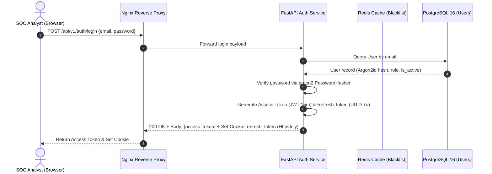
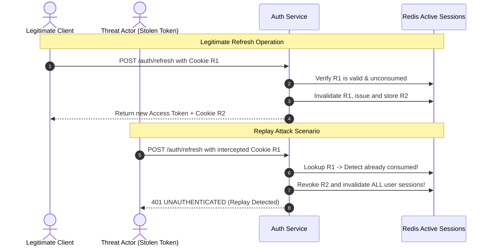

# Sentinel-X Security: Authentication & Session Management

## 1. Authentication Architecture

Sentinel-X implements a modern **dual-token stateless authentication architecture** optimized for Single Page Applications (SPAs) and microservices. It balances security, scalability, and defense against Cross-Site Scripting (XSS) and Cross-Site Request Forgery (CSRF).



---

## 2. Cryptographic Password Hashing (Argon2id)

Passwords are never stored in plaintext. Sentinel-X uses **Argon2id**, the winner of the Password Hashing Competition (PHC), which provides balanced resistance against both GPU brute-force attacks and side-channel cache attacks.

### Configuration Parameters
```python
PasswordHasher(
    time_cost=3,          # 3 iterations
    memory_cost=65536,    # 64 MiB RAM usage per hash
    parallelism=4,        # 4 concurrent execution threads
    hash_len=32,          # 256-bit output length
    salt_len=16           # 128-bit cryptographically secure random salt
)
```

---

## 3. Dual-Token Token Lifecycle

| Token Type | Lifespan | Storage Mechanism | Transport Channel | Purpose |
|:---|:---:|:---|:---|:---|
| **Access Token** | 15 Minutes | In-Memory (React Auth State) | `Authorization: Bearer <token>` | Authorizes REST and WebSocket calls |
| **Refresh Token** | 7 Days | Browser Secure Cookie Store | `Cookie: refresh_token=...` | Requests fresh access tokens |

### Access Token Claims (JWT Payload)
```json
{
  "sub": "u-a1b2c3d4-e5f6-7890",
  "email": "analyst@sentinel.internal",
  "role": "ANALYST",
  "permissions": ["telemetry:read", "telemetry:write", "incident:write"],
  "jti": "jwt-99a8b7c6-d5e4-3210",
  "iat": 1730350800,
  "exp": 1730351700,
  "iss": "sentinel-x-auth"
}
```

---

## 4. Refresh Token Rotation & Replay Attack Defense

To prevent stolen refresh tokens from providing perpetual access, Sentinel-X implements **Automatic Refresh Token Rotation with Replay Invalidation**:



### Defense Logic
1. When a refresh token ($R_1$) is used, it is immediately marked as consumed in the cache and replaced with $R_2$.
2. If an adversary attempts to use the old $R_1$, the system detects a token reuse anomaly.
3. The auth service immediately revokes $R_2$, purges all active session identifiers for that user, and creates an audit alert with classification `SECURITY_INCIDENT_REPLAY_ATTACK`.

---

## 5. Token Revocation & Logout (Blacklisting)

Because JWTs are stateless, instant logout requires active blacklisting:
1. When the client calls `POST /api/v1/auth/logout`, the server extracts the `jti` (unique JWT ID) from the Authorization header.
2. The `jti` is written to Redis with a Key-Value pair:
   `blacklist:<jti> = "revoked"` with TTL equal to the remaining expiration seconds:
   $$\text{TTL} = \text{exp} - \text{current\_time}$$
3. The `AuthenticationMiddleware` queries Redis for every request. If `blacklist:<jti>` exists, the request is rejected with HTTP 401 `UNAUTHENTICATED`.
4. The `refresh_token` cookie is cleared with `Max-Age=0`.

---

## 6. Rate Limiting & Account Lockout Defense

To neutralize credential-stuffing and automated dictionary attacks:
- **Rate Limit**: Max 5 failed login attempts per minute per IP address.
- **Sliding Window**: Implemented using Redis sorted sets (`ZADD` / `ZREMRANGEBYSCORE`).
- **Generic Error Messages**: Responses return generic `Invalid email or password` without revealing whether the email address exists in the database.
- **Timing Protection**: Password verification takes constant time regardless of email validity by hashing dummy credentials on non-existent accounts.
