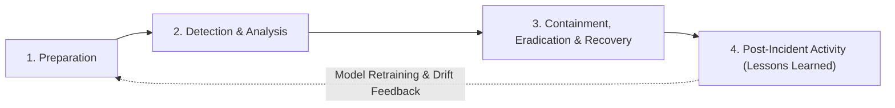

# Sentinel-X Security: Incident Response Runbook & Procedures

## 1. Incident Response Lifecycle (NIST SP 800-61 Rev 2)

Sentinel-X operational workflows adhere to the **NIST SP 800-61 Computer Security Incident Handling Guide** framework, structured into four core phases:

---

## 2. Phase-by-Phase Operational Procedures

### Phase 1: Preparation
- Ensure telemetry sensors (`data_sources`) are healthy and reporting packet streams.
- Maintain up-to-date threat intelligence indicators via AlienVault OTX feeds.
- Verify role privileges: Only `ANALYST` and `ADMIN` personnel are authorized to triage and contain incidents.

### Phase 2: Detection & Analysis (SOC Triage)
1. **Real-time Alert Receipt**:
   - The React frontend receives an urgent alert via WebSocket (`/api/v1/ws/alerts`).
   - Analyst navigates to `/incidents` to review the active incident dossier.
2. **AI Feature Attribution Review**:
   - Analyst inspects the **TreeSHAP waterfall chart** on `/detections/{id}`.
   - Example: For a classified `DDoS` attack, verify whether `flow_packets_per_second > 40,000` and `syn_flag_ratio > 0.95`.
3. **Threat Intel Verification**:
   - Execute indicator enrichment via `/api/v1/threat-intel/lookup`.
   - Check if source IP is flagged as a known Tor exit node, scanner, or malicious proxy.
4. **Classification Confirmation**:
   - If genuine: Transition incident status from `OPEN` to `INVESTIGATING`.
   - If false positive: Submit feedback via `/api/v1/detections/{id}/feedback` specifying `FALSE_POSITIVE` to prevent active model drift.

### Phase 3: Containment, Eradication & Recovery
1. **Perimeter Containment**:
   - Deploy automated firewall block rule for malicious source IP (e.g. `iptables -A INPUT -s 185.220.101.5 -j DROP`).
   - Update incident status to `CONTAINED` via `PATCH /api/v1/incidents/{id}/status`.
2. **Eradication**:
   - Terminate compromised internal host sessions if outbound beaconing was detected.
   - Clear malicious active tokens via `/api/v1/auth/logout` or user suspension (`PATCH /api/v1/users/{id} {is_active: false}`).
3. **Recovery**:
   - Validate that flow volumes on the affected interface return to baseline ($< 2,000\text{ pps}$).
   - Verify server CPU and RAM metrics stabilize on `/dashboard`.
   - Transition incident status to `CLOSED`.

### Phase 4: Post-Incident Activity & Audit Compilation
1. **Executive Reporting**:
   - Generate an automated incident dossier report via `POST /api/v1/reports/generate` with `report_type="INCIDENT_DOSSIER"`.
   - Export cryptographic PDF digest for audit compliance.
2. **Audit Verification**:
   - Inspect `/api/v1/audit-logs` to confirm every action taken by the analyst has an immutable record with matching timestamp, IP, and user ID.
3. **Active Learning Feedback Loop**:
   - Ground-truth feedback submitted during triage is queued for the next automated model retraining cycle in Celery.

---

## 3. Threat-Specific Triage Runbooks

| Threat Category | Primary Indicators | Immediate Action | Containment Verification |
|:---|:---|:---|:---|
| **DDoS (SYN Flood / UDP Flood)** | Flow packets/sec $> 50,000$; SYN flag ratio $> 0.90$; Low byte-per-packet ratio ($< 64$ bytes). | Rate-limit border router interface; deploy BGP blackhole or IP drop rule. | Ingress bandwidth drops below 10 Mbps; target service latency $< 50$ms. |
| **Port Scanning (Reconnaissance)** | High connection attempt rate to consecutive ports; RST packet ratio $> 0.85$. | Block originating external IP on perimeter firewall. | Zero connection attempts from source IP in 10-minute trailing window. |
| **Brute Force (SSH / HTTP Auth)** | Rapid authentication failures from single IP; high volume of small TCP payloads. | Enforce Redis sliding-window IP jail; alert affected system administrator. | Failed login attempts drop to zero; no unauthorized access occurred. |
| **Command & Control (Botnet)** | Periodic beaconing interval (low jitter); high DNS query volume to randomized domains. | Isolate infected internal machine to VLAN quarantine; revoke user tokens. | Internal host disconnected from network; outbound DNS queries halted. |
