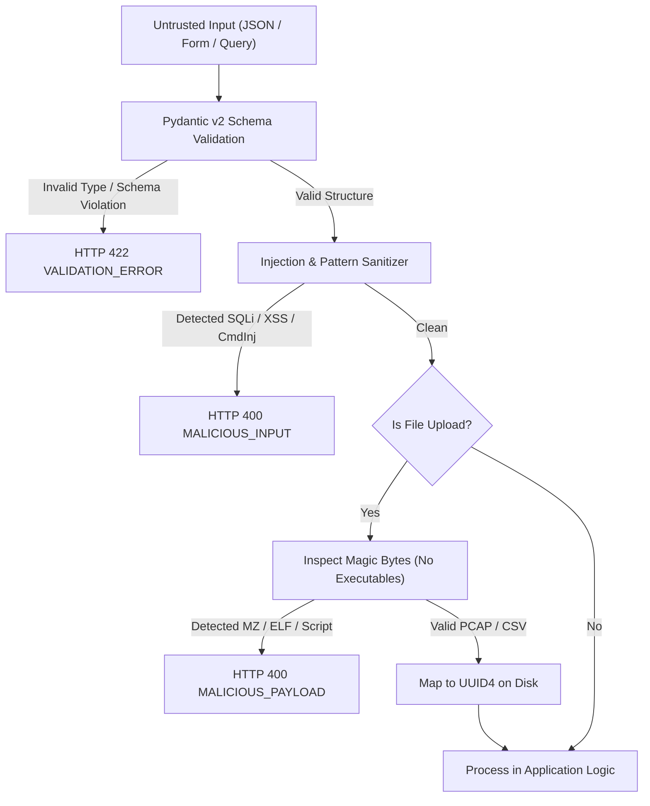

# Sentinel-X Security: Input Validation & Sanitization Architecture

## 1. Defensive Validation Strategy

Sentinel-X enforces **positive security (strict allowlisting)** across all ingestion boundaries. Untrusted data from HTTP requests, query parameters, multipart uploads, and WebSocket streams must satisfy strict structural, type, and behavioral constraints before reaching business logic.



---

## 2. Pydantic Schema Enforcement

All request payloads are parsed through Pydantic v2 models with strict type evaluation and forbidden extra fields (`model_config = ConfigDict(extra="forbid")`):

```python
class FeedbackCreateRequest(BaseModel):
    model_config = ConfigDict(extra="forbid")

    feedback_type: Literal["TRUE_POSITIVE", "FALSE_POSITIVE"]
    corrected_label: Annotated[str, StringConstraints(min_length=2, max_length=50, pattern=r"^[a-zA-Z0-9_\-\s]+$")]
    comment: Optional[Annotated[str, StringConstraints(max_length=1000)]] = None
```

---

## 3. Specific Attack Vector Mitigations

### 3.1 SQL Injection (SQLi)
- **Primary Defense**: Complete avoidance of raw string formatting/concatenation in SQL queries. 100% of queries use **SQLAlchemy ORM 2.0** with bound parameters.
- **Secondary Defense**: Inbound string filters match against common injection signatures (`SQLI_PATTERNS`):
  `r"(\b(UNION|SELECT|INSERT|DELETE|UPDATE|DROP|ALTER|EXEC|EXECUTE)\b|--|\/\*|\*\/|;)"`

### 3.2 Cross-Site Scripting (XSS)
- **React Escaping**: React JSX automatically contextually escapes string interpolation, rendering `<script>` tags as inert text nodes.
- **Content-Security-Policy (CSP)**: `default-src 'self'; script-src 'self'; style-src 'self' 'unsafe-inline';`
- **Output Sanitization**: API serialization strips raw HTML tags from user-provided notes and comments before rendering.

### 3.3 Command Injection
- No direct subshell execution (`os.system` or `shell=True` in `subprocess`) is permitted within the application core.
- Any background worker tasks that run command-line tools (e.g. `tshark` or `tcpdump`) pass argument vectors directly as a list (`['tshark', '-r', sanitized_path]`), bypassing the system shell parser.

### 3.4 Path Traversal (`../`)
- Uploaded filenames (`original_filename`) are scrubbed using `os.path.basename` and stripped of `.` and `/` sequences.
- Persisted files are stored in an isolated scratch/quarantine directory using deterministic UUIDv4 filenames (e.g. `/var/sentinel/uploads/3fa85f64-5717-4562-b3fc-2c963f66afa6.pcap`).
- Path canonicalization (`os.path.realpath`) verifies that file access remains strictly within the intended base directory.

### 3.5 File Upload & Magic Byte Abuse
To prevent attackers from disguising executable binaries as CSV or PCAP files:
```python
FORBIDDEN_MAGIC_SIGNATURES = [
    b"MZ",              # Windows PE Executable / DLL
    b"\x7fELF",         # Linux Executable and Linkable Format
    b"\xca\xfe\xba\xbe", # Java Class File / Mach-O Binary
    b"#!/bin/",         # Shell Script Shebang
    b"<?php",           # PHP Web Shell
]
```
The ingestion service reads the first 16 bytes of every uploaded file. If any forbidden magic signature matches, the upload is terminated with HTTP 400 `MALICIOUS_PAYLOAD` and immediately purged from temporary buffers.

### 3.6 CSV Injection & Decompression Bomb Protection
- **Formula Escape**: Cell values beginning with `=`, `+`, `-`, or `@` are prefixed with `'` to prevent formula execution in Microsoft Excel or Google Sheets.
- **Decompression / Column Limit**: CSV files are capped at **100 columns** and 100MB to neutralize column-expansion memory attacks.

### 3.7 Server-Side Request Forgery (SSRF)
- Threat intelligence lookups strictly parse indicators using `ipaddress.ip_address()`.
- The following IP classes are rejected:
  - Private subnets: `10.0.0.0/8`, `172.16.0.0/12`, `192.168.0.0/16`
  - Loopback addresses: `127.0.0.0/8`
  - Link-local addresses: `169.254.0.0/16`
  - Reserved documentation networks: `198.51.100.0/24` (TEST-NET-2), `192.0.2.0/24` (TEST-NET-1), `203.0.113.0/24` (TEST-NET-3).
