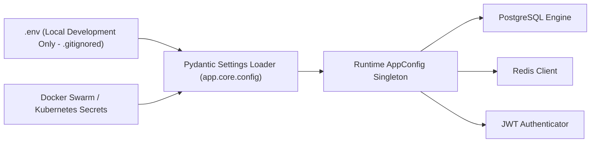

# Sentinel-X Security: Secrets Management & Data Sanitization

## 1. Secrets Architecture & Storage

Sentinel-X enforces a **Zero-Secret Exposure Policy**. No API keys, database credentials, cryptographic salts, or authentication secrets may be hardcoded into source code, committed to version control, or rendered in client-facing HTTP payloads.

### Secret Hierarchy & Environmental Sources
All application secrets are managed centrally through **`pydantic-settings`** and injected exclusively via environment variables or Docker secrets:



---

## 2. Inventory of Sensitive System Secrets

| Variable Name | Description | Minimum Length / Format | Rotation Frequency |
|:---|:---|:---|:---|
| `JWT_SECRET` | HS256 JWT cryptographic signing key | 32 bytes (256 bits) random string | 90 Days |
| `POSTGRES_PASSWORD` | PostgreSQL master database user password | 24 characters high-entropy | 90 Days |
| `REDIS_PASSWORD` | Redis AUTH credential | 24 characters alphanumeric | 90 Days |
| `THREAT_INTEL_API_KEY` | External OTX / VirusTotal enrichment key | 64 characters hex | Vendor Scheduled |
| `ADMIN_INITIAL_PASSWORD` | Seed password for initial admin account | 16 characters complex | Reset upon first login |

---

## 3. Log Redaction & Data Sanitization

To ensure that sensitive identifiers are never persisted in plain text within console logs, Docker container outputs, or ELK/Loki aggregators, Sentinel-X employs custom JSON formatting with recursive regex scrubbing.

### Redaction Filter Implementation (`app.core.logging.redact_data`)
```python
REDACT_KEYS = {"password", "secret", "token", "access_token", "refresh_token", "authorization", "api_key"}

def redact_data(data: Any) -> Any:
    """Recursively scrub sensitive keys and regex patterns from dictionaries and lists."""
    if isinstance(data, dict):
        return {
            k: "[REDACTED]" if any(sensitive in k.lower() for sensitive in REDACT_KEYS)
            else redact_data(v)
            for k, v in data.items()
        }
    elif isinstance(data, list):
        return [redact_data(item) for item in data]
    elif isinstance(data, str):
        # Mask Bearer tokens
        data = re.sub(r"Bearer\s+eyJ[a-zA-Z0-9_\-\.]+", "Bearer [REDACTED]", data)
        # Mask potential credit card PANs
        data = re.sub(r"\b(?:\d{4}[-\s]?){3}\d{4}\b", "[REDACTED_PAN]", data)
        return data
    return data
```

---

## 4. Secret Leak Verification & Git Hygiene

1. **`.gitignore` Enforcement**:
   - `.env`, `.env.production`, `*.pem`, `*.key`, `*.pfx`, and `jwt_secret.txt` are explicitly barred from version control.
2. **Automated Leak Tests**:
   - The test suite `backend/tests/security/test_secret_leak_security.py` executes regular expression audits across source files and git commits to guarantee no high-entropy private keys or credentials are leaked.
3. **Container Isolation**:
   - Production Docker images do not bundle `.env` files; secrets are injected dynamically at container initialization time using environment variables or volume mounts.
