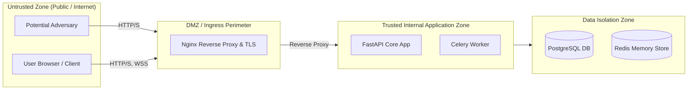

# Sentinel-X: Architectural Threat Model (STRIDE)

## 1. Scope & Objective

This threat model identifies potential threats, attack surfaces, and architectural countermeasures implemented across the Sentinel-X network security and AI telemetry platform using the Microsoft STRIDE methodology.

---

## 2. Trust Boundaries

- **Boundary 1: Internet to Reverse Proxy (Nginx):** External traffic entering the network. Must withstand volumetric flooding, slowloris attacks, and unauthenticated probing.
- **Boundary 2: Reverse Proxy to Application (FastAPI):** Application-level authentication, rate limiting, and parameter validation.
- **Boundary 3: Application to Database / Redis:** Database credentials, SQL injection, connection hijacking.
- **Boundary 4: Application to External Intelligence (VirusTotal/AbuseIPDB):** Server-Side Request Forgery (SSRF), external data poisoning.

---

## 3. STRIDE Threat Analysis & Defensive Mitigations

### 3.1 Spoofing (Identity Deception)
| Threat | Attack Scenario | Countermeasure |
| :--- | :--- | :--- |
| **Token Forgery** | Attacker crafts self-signed JWT with `role: ADMIN`. | HS256 JWT signatures validated against 256-bit `JWT_SECRET`; issuer and expiry strictly checked. |
| **Credential Guessing** | Automated brute-force attacks against `/auth/login`. | Argon2id slow hashing + sliding-window rate limit (5 attempts/min/IP) + generic 401 error message. |
| **Session Hijacking** | Stealing access token from local storage. | Access token kept in memory only; refresh token kept in `HttpOnly`, `SameSite=Lax`, `Secure` cookie. |

### 3.2 Tampering (Data Modification)
| Threat | Attack Scenario | Countermeasure |
| :--- | :--- | :--- |
| **SQL Injection** | Injection strings in query parameters (`' OR 1=1`). | SQLAlchemy ORM parameterized queries; regex allowlisting on search queries (`SQLI_PATTERNS`). |
| **CSV Formula Injection** | Attacker uploads CSV containing `=cmd|' /C calc'!A0`. | Sanitization prefixes formula control characters (`=, +, -, @`) with `'` in quarantine pipeline. |
| **Path Traversal** | Filenames with `../../etc/passwd` to overwrite files. | Filename rejected if path separators present; discarded on disk and replaced with UUID4. |

### 3.3 Repudiation (Denial of Actions)
| Threat | Attack Scenario | Countermeasure |
| :--- | :--- | :--- |
| **Denial of Incident Modification** | Rogue analyst changes incident status to `FALSE_POSITIVE` and denies it. | Centralized immutable `AuditLog` table records user ID, IP, action, timestamp, and metadata. |
| **Untracked Requests** | Inability to trace errors or actions through services. | Unique `X-Request-ID` propagated in HTTP headers and structured JSON logs. |

### 3.4 Information Disclosure (Data Leakage)
| Threat | Attack Scenario | Countermeasure |
| :--- | :--- | :--- |
| **Credential Leakage in Logs** | Password or JWT printed to log file or console. | `StructuredJsonFormatter` recursively replaces `password`, `token`, `secret`, `key` with `[REDACTED]`. |
| **SSRF to Cloud Metadata** | Analyst queries `169.254.169.254` via threat intel. | IP validator rejects private, loopback, link-local, multicast, and non-routable addresses before request dispatch. |
| **Stack Trace Leakage** | Database error dumps raw SQL schema to API client. | Centralized exception handlers catch all exceptions and emit generic error messages without tracebacks. |

### 3.5 Denial of Service (Resource Starvation)
| Threat | Attack Scenario | Countermeasure |
| :--- | :--- | :--- |
| **Large File Upload Exhaustion** | Attacker uploads 5 GB file to exhaust RAM. | Ingestion checks Content-Length and buffer size; strictly rejects uploads exceeding 10 MB. |
| **API Endpoint Flooding** | Rapid requests to report generation or threat intel. | Redis sliding-window rate limiting throttles requests with HTTP 429 and `Retry-After` headers. |
| **ReDoS (Regex Denial of Service)** | Malicious email string stalls regex parser. | Tested precompiled regular expressions with bounded lengths. |

### 3.6 Elevation of Privilege (Unauthorized Access)
| Threat | Attack Scenario | Countermeasure |
| :--- | :--- | :--- |
| **Viewer Activating Models** | Viewer role executes `POST /api/v1/models/{id}/activate`. | Server-side `RoleChecker(["ADMIN"])` rejects with HTTP 403 `AUTHORIZATION_DENIED`. |
| **Analyst Creating Admin Users** | Analyst executes `POST /api/v1/users`. | Server-side authorization blocks user management routes for non-ADMIN callers. |

