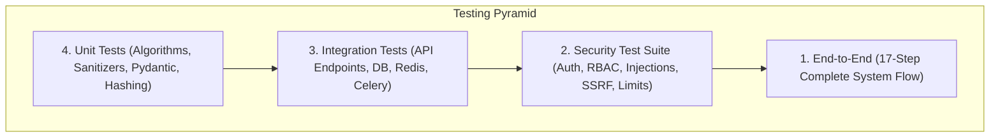

# Sentinel-X: Comprehensive Test Plan & Verification Strategy

## 1. Test Philosophy & Quality Gates

Sentinel-X adheres to a strict **Automated Verification Loop**. A milestone or feature is never deemed complete based solely on superficial UI functionality. A feature is complete only when unit tests, integration contracts, security penetration tests, and frontend type-checking pass with **100% success**.



---

## 2. Test Suite Breakdown

### 2.1 Unit Testing Layer
- **Scope**: Isolated function and component verification without persistent external dependencies.
- **Coverage**:
  - `Argon2id` password hashing, salt verification, and constant-time comparison.
  - JWT token generation, signature validation, expiration checking, and claim parsing.
  - Telemetry feature vector parsing, normalization, and statistical extraction.
  - TreeSHAP feature importance computation and attribution sorting.
  - Logging redaction algorithm (`redact_data`).

### 2.2 Integration Testing Layer
- **Scope**: Component interactions across FastAPI, SQLAlchemy 2.0 (PostgreSQL), Redis, and Celery.
- **Coverage**:
  - Full HTTP request/response lifecycle using `httpx.AsyncClient`.
  - Database schema migrations, model relationships, unique constraints, and cascade behaviors.
  - Multipart upload parsing and temporary quarantine storage handling.
  - Celery asynchronous task queuing and result backend retrieval.
  - Real-time WebSocket connection upgrades, subscriptions, and broadcast delivery.

### 2.3 Security Testing Layer (`tests/security/`)
Dedicated adversarial test suite validating hardening controls against common cyberattacks:
1. **`test_authentication_security.py`**:
   - Replay attack rejection on rotated refresh tokens.
   - Immediate session invalidation on token revocation/logout.
   - Lockout and rate limiting on brute-force login attempts.
2. **`test_authorization_security.py`**:
   - Least-privilege boundary enforcement across `ADMIN`, `ANALYST`, and `VIEWER`.
   - Verify `VIEWER` receives HTTP 403 on ingestion, feedback, incident updates, model promotion, and audit log access.
3. **`test_injection_security.py`**:
   - SQL Injection rejection on search and query endpoints (`' OR 1=1 --`, `UNION SELECT`).
   - Cross-Site Scripting (XSS) input encoding and CSP header verification.
   - Command injection vector neutralization in parameter parsing.
   - Path traversal prevention on file upload endpoints (`../../etc/shadow`).
4. **`test_ssrf_security.py`**:
   - Threat intel indicator lookup rejection of private IPv4/IPv6 ranges (`10.0.0.0/8`, `192.168.1.1`).
   - Loopback rejection (`127.0.0.1`, `localhost`).
   - Cloud metadata IP rejection (`169.254.169.254`).
   - Reserved test networks rejection (`198.51.100.1`).
5. **`test_ratelimit_security.py`**:
   - Sliding-window token-bucket enforcement on authentication and heavy report generation endpoints.
6. **`test_file_upload_security.py`**:
   - Magic byte rejection of Windows PE executables (`MZ`), Linux binaries (`\x7fELF`), and scripts (`#!/bin/sh`).
   - Rejection of oversized payloads ($> 100\text{MB}$) and CSV decompression bombs ($> 100$ columns).
7. **`test_secret_leak_security.py`**:
   - Source code and response payload regex scanning to ensure zero hardcoded secrets or exposed private keys.

### 2.4 End-to-End (E2E) 17-Step Demonstration Flow
Simulates a real-world SOC analyst day-in-the-life workflow in `tests/e2e/test_end_to_end_demonstration.py`:
1. Authenticate as SOC Analyst (`POST /auth/login`).
2. Query system health and verify database/Redis connectivity (`GET /health`).
3. Ingest malicious PCAP/CSV network telemetry (`POST /ingestion/upload`).
4. Await asynchronous Celery ML classification task completion.
5. Query detection feed and confirm classified `DDoS` attack (`GET /detections`).
6. Request TreeSHAP local explainability values (`GET /detections/{id}/shap`).
7. Perform threat intelligence reputation enrichment on attacker IP (`POST /threat-intel/lookup`).
8. Correlate detection into a security incident dossier (`POST /incidents`).
9. Update incident status to `INVESTIGATING` (`PATCH /incidents/{id}/status`).
10. Submit ground-truth analyst feedback on model classification (`POST /detections/{id}/feedback`).
11. Update incident status to `CONTAINED` after mitigation (`PATCH /incidents/{id}/status`).
12. Close incident with resolution comments (`PATCH /incidents/{id}/status`).
13. Generate executive security PDF/JSON report (`POST /reports/generate`).
14. Download compiled report artifact (`GET /reports/{id}/download`).
15. Authenticate as Administrator (`POST /auth/login`).
16. Query immutable audit trail to verify all analyst actions were logged (`GET /audit-logs`).
17. Log out and confirm token invalidation (`POST /auth/logout`).

---

## 3. Frontend Build & Static Typing Verification

- **TypeScript Engine**: `tsc --noEmit` checks 100% of types across routes, stores, API hooks, and UI components.
- **Vite Bundler**: Production build verification (`vite build`) ensures zero tree-shaking failures or unresolvable assets.

---

## 4. Execution Commands

```bash
# Backend Test Suite Execution
cd sentinel-x/backend
pytest tests/ -v --tb=short

# Frontend Static Verification & Build
cd ../frontend
npm run build
```

