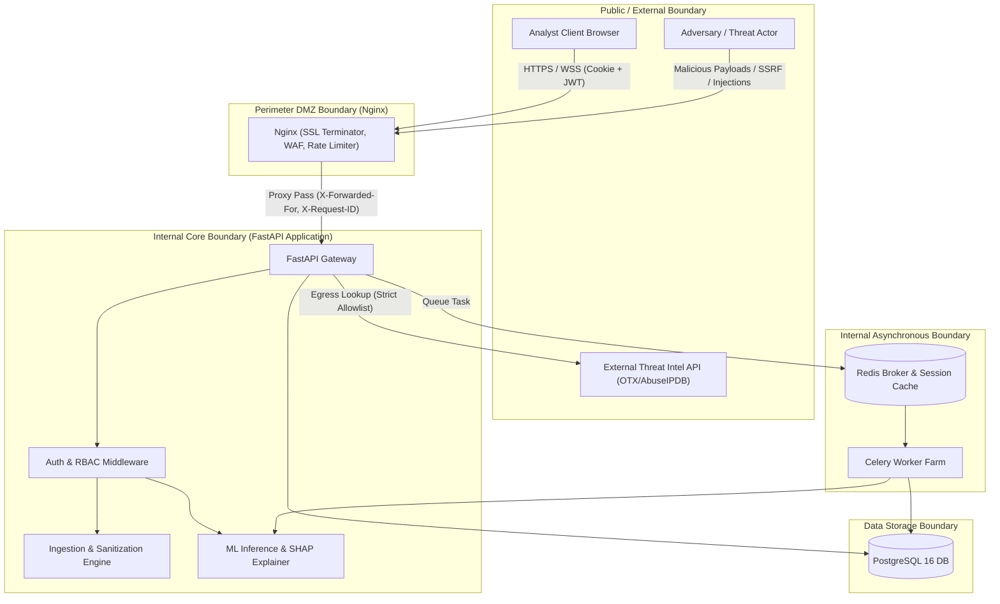
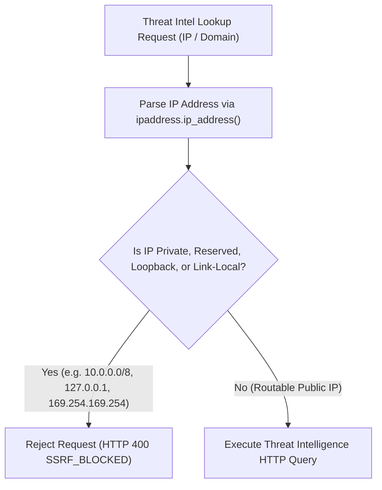

# Sentinel-X Security: Application Threat Model (STRIDE)

## 1. Scope & System Trust Boundaries

This threat model documents the application-level security boundaries, STRIDE classification, attack trees, and defense-in-depth countermeasures for the Sentinel-X AI Security Operations platform.

---

## 2. STRIDE Threat Matrix & Architectural Controls

### 2.1 Spoofing (Identity Masquerading)
* **Threat**: Adversary attempts to forge authentication tokens, impersonate administrative users, or bypass MFA/SSO controls.
* **Impact**: Full administrative takeover, unauthorized telemetry access, compromised audit trails.
* **Defensive Controls**:
  - Cryptographically secure **Argon2id** password hashing (`time_cost=3`, `memory_cost=65536`, `parallelism=4`).
  - **HS256 JWT tokens** signed with 256-bit cryptographically random `JWT_SECRET`.
  - Token claims enforce strict `exp` (15 min limit), `sub` (UUID), `role`, and `jti` (unique token ID).
  - Sliding window rate limiting on `/auth/login` (5 failed attempts per 60s per IP) to mitigate brute force.
  - Refresh tokens stored in `HttpOnly`, `SameSite=Strict`, `Secure` cookies with automatic rotation and replay invalidation.

### 2.2 Tampering (Data Modification)
* **Threat**: Modification of telemetry data in transit, injection of SQL/NoSQL payloads, or corruption of ML model weights.
* **Impact**: False positive/negative reporting, privilege escalation, server compromise.
* **Defensive Controls**:
  - **SQL Injection**: 100% parameterized queries via SQLAlchemy ORM; regex validation filters (`SQLI_PATTERNS`).
  - **File Upload Integrity**: File content inspection via magic bytes (`python-magic`); forbidden headers (`MZ`, `ELF`, Java Mach-O) rejected immediately.
  - **CSV Formula Injection**: Automatic prefixing with single-quotes (`'`) for `=, +, -, @` character sequences.
  - **Path Traversal**: Uploaded filenames stripped of path separators; files written to quarantined storage using UUIDv4 filenames.

### 2.3 Repudiation (Denial of Actions)
* **Threat**: Malicious insider or compromised analyst denies modifying incident statuses, clearing threat alerts, or altering system configurations.
* **Impact**: Inability to conduct forensic attribution; regulatory non-compliance.
* **Defensive Controls**:
  - Dedicated **`audit_logs` table** capturing all state-mutating actions (create, update, delete, promote, feedback).
  - Audit records capture: `user_id`, `user_email`, `action`, `resource_type`, `resource_id`, `ip_address`, `status`, `details`, and `timestamp`.
  - Database-enforced immutable log design (no update/delete permissions granted on audit tables to application roles).

### 2.4 Information Disclosure (Data Leakage)
* **Threat**: Leakage of API tokens, database credentials, internal IPs, or PII through HTTP responses, stack traces, or log outputs.
* **Impact**: Lateral movement, external reconnaissance, breach of confidentiality.
* **Defensive Controls**:
  - Structured logging with `redact_data()` regex filtering replacing credit cards, passwords, and bearer tokens with `[REDACTED]`.
  - Production `DEBUG=False` mode ensures FastAPI returns generic error envelopes (`500 INTERNAL_SERVER_ERROR`) without raw tracebacks.
  - Strict Pydantic response models preventing sensitive database columns (`password_hash`, internal salt) from serializing in JSON.

### 2.5 Denial of Service (Resource Exhaustion)
* **Threat**: Flooding ingestion endpoints with massive PCAP/CSV files, executing high-complexity SQL queries, or exhausting WebSocket connections.
* **Impact**: SOC operational blindness, system downtime.
* **Defensive Controls**:
  - Hard limit on file uploads (max 100MB) enforced by Nginx `client_max_body_size` and FastAPI `Content-Length` checks.
  - Max 100 CSV columns allowed in `IngestionService` to neutralize CSV decompression bombs.
  - Redis token-bucket sliding-window rate limiters per client IP on heavy endpoints (e.g. `/reports/generate`, `/ingestion/upload`).
  - Celery asynchronous task distribution prevents long-running ML model inference from blocking the HTTP event loop.

### 2.6 Elevation of Privilege (Unauthorized Actions)
* **Threat**: A `VIEWER` or unauthenticated actor invokes administrative APIs (`/users`, `/models/promote`, `/incidents/{id}/status`).
* **Impact**: Rogue model deployments, unauthorized incident closure, unauthorized account provisioning.
* **Defensive Controls**:
  - Explicit role checks (`RoleChecker(["ADMIN"])`, `RoleChecker(["ADMIN", "ANALYST"])`) enforced at route dependency injection layer.
  - Centralized authorization middleware verifying database-backed permissions on every authenticated route.
  - Negative security unit & integration test suites validating HTTP 403 on all unauthorized privilege escalations.

---

## 3. Server-Side Request Forgery (SSRF) Defense

Threat intelligence feeds require querying external IPs/domains. To prevent adversaries from forcing Sentinel-X to pivot against internal cloud metadata (`169.254.169.254`) or private subnets:

